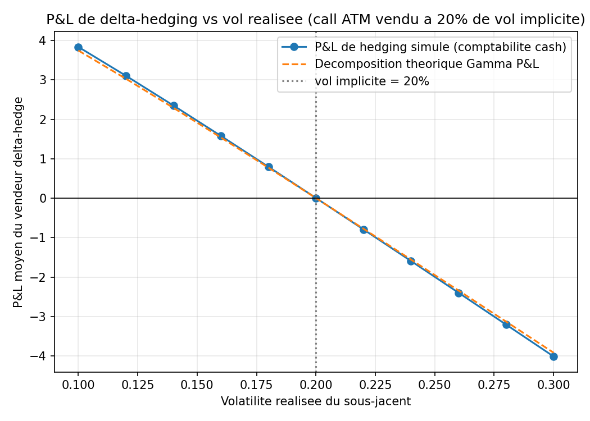

Option pricer et delta-hedging (Black-Scholes + Monte-Carlo)

Pricing d'options europeennes, greeks, volatilite implicite et backtest de
delta-hedging. Le sous-jacent suit un mouvement brownien geometrique
(vol et taux constants, sans frictions).

Contenu:
- Black-Scholes analytique, Monte-Carlo avec variables antithetiques
  (variance divisee par ~2 a la monnaie)
- Greeks analytiques et par differences finies (common random numbers)
- Vol implicite par Newton-Raphson avec repli sur la bissection
- Delta-hedging d'un call vendu, P&L compare a la decomposition Gamma

Utilisation:
pip install -r requirements.txt
python main.py
pytest -q

Graphique: un call ATM vendu a 20% de vol implicite, couvert chaque jour.
Si la vol realisee monte a 25%, le vendeur perd en moyenne 1.98. Le P&L simule
colle a la decomposition theorique a 2.4% pres.

Limites: pas de smile, de sauts, de dividendes ni de couts de transaction.
